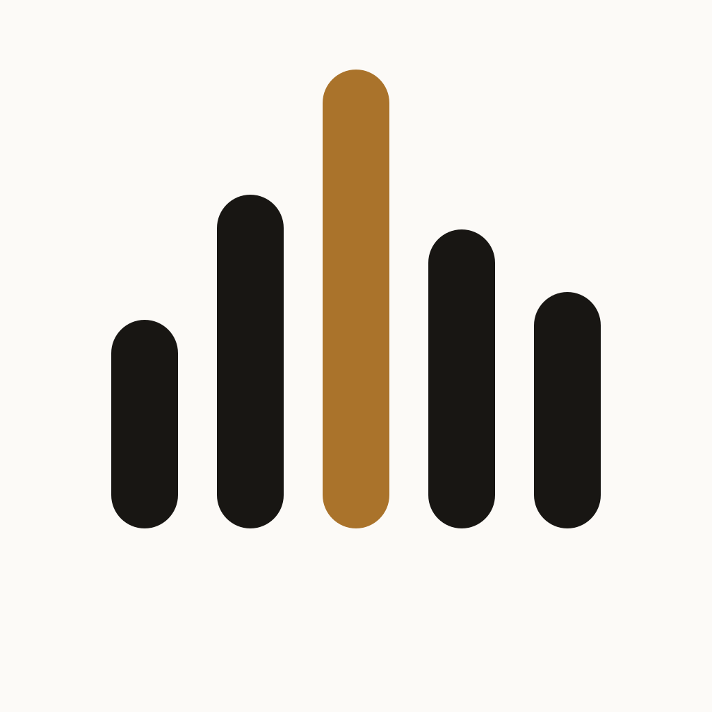
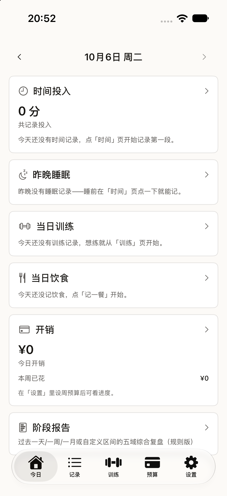
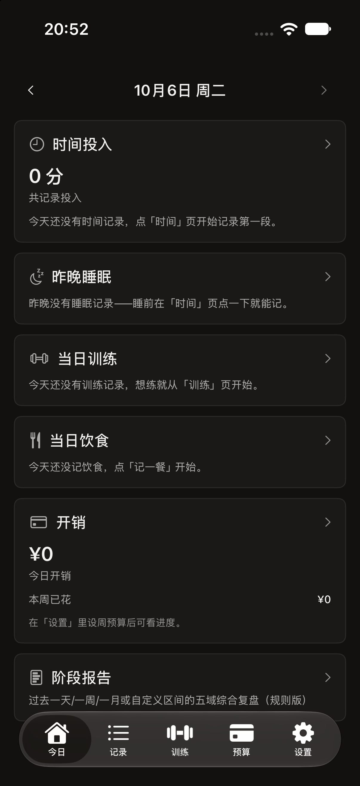
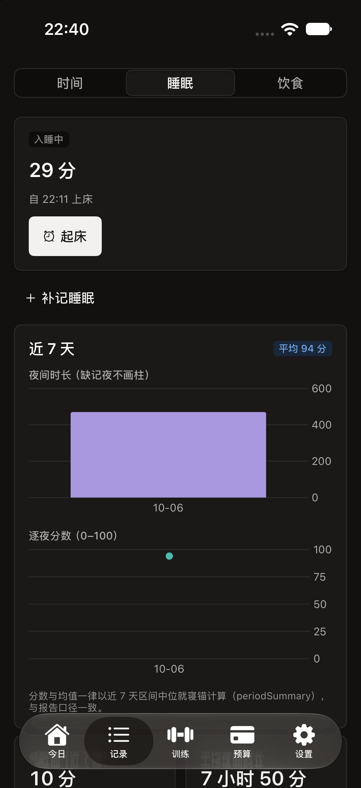
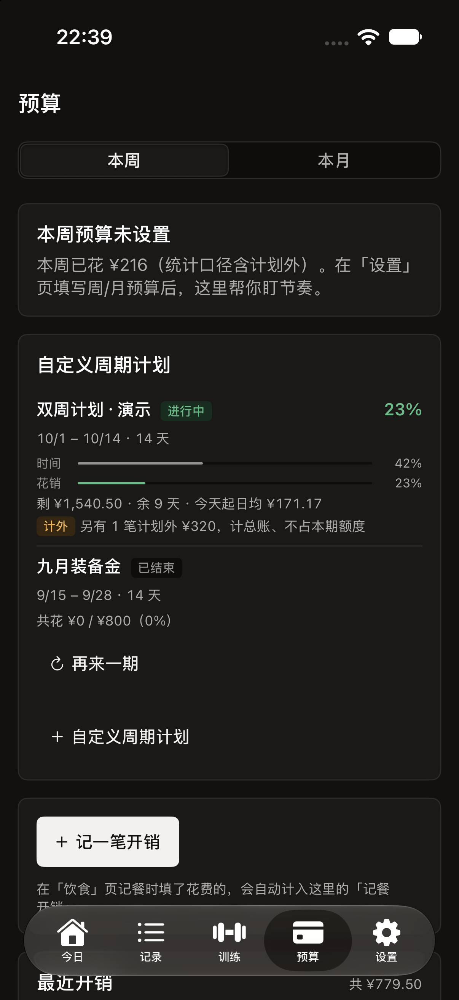

# SelfRecord

<p align="center">
  <picture>
    <source media="(prefers-color-scheme: dark)" srcset="assets/logo-dark.svg">
    
  </picture>
</p>

「生活量化五件套」iOS 应用：**时间分配 + 睡眠 + 训练 + 饮食 + 预算** 五个域各自独立记录，靠跨域联动互相喂养——练后餐预选、恢复建议读实际蛋白摄入、记餐花费自动入账、训练耗时聚合、五域合一的日简报。

> 五根柱 = 五个域，中柱赭石点睛——「颜色承载含义，而非装饰」（设计语言来自 [Ely](https://github.com/ZacharyZhang-NY/Ely-GPUI-Components)）。整体思路参考安卓端的 [练时 LiftTime](https://github.com/nanami-0713/lifttime)，按 iOS 原生习惯重新设计。

## 下载与安装（iOS 17+）

从 [Releases](https://github.com/nanami-0713/self-record/releases) 下载 `SelfRecord-vX.Y.Z-ios-unsigned.ipa`。**包未签名**（本仓库无开发者账号），三种安装方式任选：

| 方式 | 说明 |
| --- | --- |
| [AltStore](https://altstore.io) / [Sideloadly](https://sideloadly.io) | 免费 Apple ID 自签，7 天续签一次，最常用 |
| 付费开发者账号 | `xcodebuild -exportArchive` 或直接 Xcode 里对 ipa 重签 |
| TrollStore 设备 | 直接安装 |

有 Xcode 的话也可以拉源码自建：`brew install xcodegen && cd app && xcodegen generate && open SelfRecord.xcodeproj`，Cmd+R 即跑。

- **架构**：模块化 Swift Package——`SelfRecordCore`（Foundation-only 纯逻辑引擎 + 分域 JSON 存储 + 备份净化管线）与 `SelfRecordUI`（SwiftUI + Swift Charts，Ely 设计语言令牌与组件）；iOS 应用入口 `app/SelfRecordApp.swift`（@main + 根 TabView 五 Tab）不在 Package target 内，由 XcodeGen 工程单独编译。
- **设计基线**：[docs/design.md](docs/design.md)（页面地图、数据口径、设计令牌、本机环境事实，全部设计决策的出处）。
- **质量线**：Core 全部为值类型纯函数 + Swift Testing 覆盖（口径锚点移植自 lifttime 的测试基线，见 design.md §10）。

## 如何验证

```bash
swift build          # 编译 SelfRecordCore + SelfRecordUI（host macOS 构建）
swift test           # 跑全部测试（完整 Xcode 工具链下直接可用）
./scripts/test.sh    # 兼容入口：仅命令行工具（CLT）环境时用它（自带宏插件搜索路径）
```

> 环境说明（2026-10-06 起本机已装完整 Xcode）：`xcode-select` 指向 Xcode 后裸 `swift test` 可用；若切回 CLT-only 环境，Swift Testing 宏插件不被自动搜索，请改用 `scripts/test.sh`（详见 design.md §12.4）。`swift build` 两种环境裸命令均可。

## 装好 Xcode 后如何生成工程并运行

```bash
brew install xcodegen
cd app
xcodegen generate        # 按 app/project.yml 生成 app/SelfRecord.xcodeproj（产出不入库）
open SelfRecord.xcodeproj
```

Xcode 中选 iOS 17+ 模拟器，Cmd+R 运行。工程规格在 `app/project.yml`：App target 引用 `app/SelfRecordApp.swift` 与本地 package 的两个 library（`SelfRecordCore` / `SelfRecordUI`），部署目标 iOS 17+，支持明暗主题（跟随系统；应用内经设置页手动覆盖）。

> ✅ 2026-10-06 已在本机完成 iOS 真实验收（Xcode 27 / iOS 27 模拟器）：`xcodegen generate` → `xcodebuild` 构建、198 项测试全绿、模拟器安装启动、明暗双主题截图确认（docs/screenshots/）。验收中修复的三个问题见 [docs/delivery-report.md](docs/delivery-report.md) 的「验收补录」。

## 界面一览

<p>




</p>

## 目录结构

```
self-record/
├── Package.swift             # 单 package 双 library：SelfRecordCore / SelfRecordUI
├── Sources/
│   ├── SelfRecordCore/       # Foundation-only：Model / Storage / TimeKit 基础层
│   │                         # + TimeTracking / Sleep / Workout / Diet / Budget / Report 六模块
│   └── SelfRecordUI/         # SwiftUI + Charts：DesignSystem 令牌与组件 + AppModel 状态容器
│                             # + Today / Records / Workout / Budget / Settings 五界面分组 + iOS/（iOS-only 收敛地）
├── Tests/SelfRecordCoreTests/  # Swift Testing（经 scripts/test.sh 运行）
├── app/                      # 不参与 swift build（不在任何 Package target 内）
│   ├── SelfRecordApp.swift   # @main 入口 + 根 TabView（按 design.md §6 页面地图接线）
│   └── project.yml           # XcodeGen 规格（App target + 本地 package 双 library）
├── scripts/test.sh           # 测试统一入口（CLT 环境适配，见上）
├── docs/                     # design.md（设计基线）+ reference-lifttime.md / reference-ely.md（参考分析）
└── reference/                # 外部参考材料（见下）
```

## reference/ 目录说明

`reference/`（`lifttime/` 与 `ely/`）是设计阶段使用的外部参考材料：lifttime 是功能蓝图与测试基线的来源 PWA，ely 是设计语言来源。它们**不属于本项目代码，已被 `.gitignore` 忽略、不入库**；克隆后此目录为空是正常现象，相关结论已固化进 `docs/design.md` 与 `docs/reference-*.md`，构建与测试均不依赖它。
